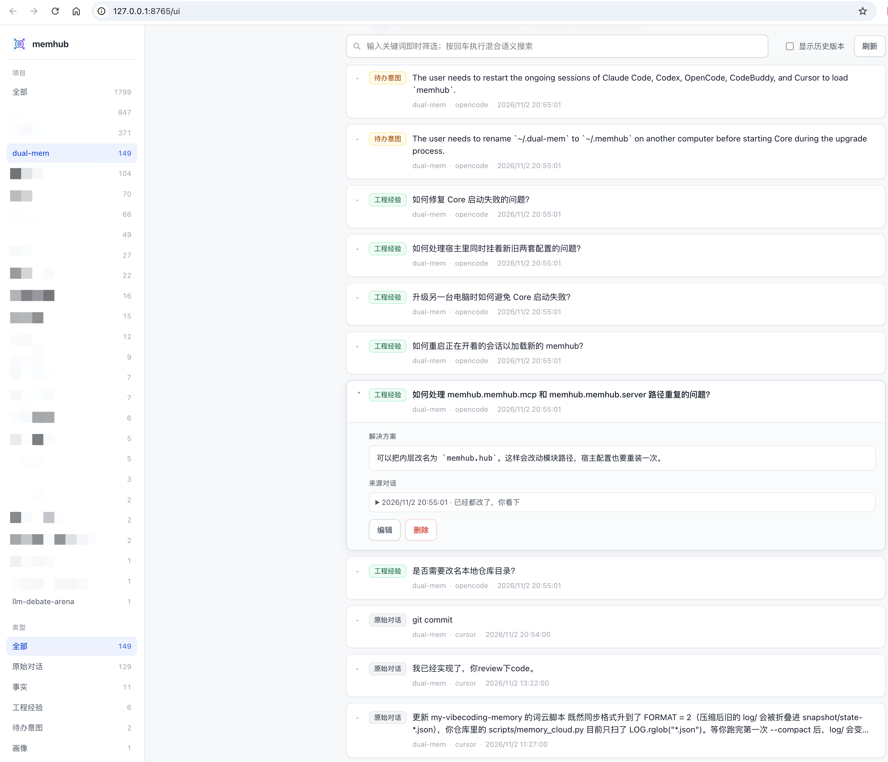

# MemHub：跨 AI 工具共享你的个人记忆

在 Cursor 里交代过的偏好，Codex 并不知道；在 Claude Code 里定下的规范，到了 Hermes 又要重新说明。

**MemHub 让你的 AI 工具共享一份个人记忆。** 记忆是你的长期资产，不被任何单一工具锁定，每次开口都从懂你开始。

```text
 Claude Code  Codex  Cursor  Hermes  Agentica  CodeBuddy  OpenCode  WorkBuddy  Kimi  DeepSeek Harness  Trae  ZCode  Qoder  Copilot  Kiro  Cline  Pi  OpenClaw
      \         \      |       |        |          |         /         /
       ───────────────────────────  MemHub  ───────────────────────────
                                      │
                         你的个人记忆（每台电脑一份，可跨设备同步）
```

## 你会得到什么

- **说一次，处处生效**：在一个工具里提过的偏好、规范和项目背景，其他工具自动知道。
- **零配置**：工具自动发现本机的记忆服务，不用填地址，也不用复制密钥。
- **不拖慢工作**：对话先存下来立刻返回，整理在后台进行。
- **历史不浪费**：已有的会话记录一键导入，第一天就"懂你"。
- **数据归你**：默认只存在你的电脑上；多台电脑可以经你自己的网盘文件夹、git 仓库或服务器同步。

当前支持：**Claude Code、Codex、Cursor、Hermes、Agentica、CodeBuddy、OpenCode、WorkBuddy、Kimi（kimi-cli / kimi-code）、DeepSeek Harness、Trae、ZCode、Qoder、GitHub Copilot、AWS Kiro、Cline、Pi、OpenClaw**。更多工具正在接入，见 [Roadmap](https://github.com/shibing624/memhub#roadmap)。

## 三步开始

```bash
pip install "memhub[all]"

# 1. 启动记忆服务（登录后自动运行）
memhub install-service

# 2. 按需接入你本机正在用的 AI 工具（卸载用 memhub uninstall-host <工具名>）
#    不带参数时会自动探测本机已安装的工具，只接入它们：
memhub install-host
memhub install-host claude-code
memhub install-host codex
memhub install-host cursor
# 支持：claude-code | codex | cursor | agentica | hermes | codebuddy | opencode | workbuddy | kimi-cli | kimi-code | dsh | trae | zcode | qoder | copilot | kiro | cline | pi | openclaw
# 也可以一键接入全部：memhub install-host all

# 3.（可选）导入过去的对话历史
memhub scan --source claude-code   # 或 --source all 导入全部
```

然后就可以问了：

```bash
memhub recall "我之前做过哪些技术选择"
memhub status
memhub ui        # 在浏览器里按项目浏览、搜索、编辑、删除记忆
```

> 自启服务不继承 shell 环境变量，模型 API key 请写在 `~/.memhub/config.yaml`。

## 本机记忆管理页（`memhub ui`）

在终端运行：

```bash
memhub ui
```

会在浏览器打开 `http://127.0.0.1:8765/ui`（页面由本机已经在跑的 Core 提供，无需额外安装；访问令牌放在 URL 的 `#` 片段里，不进服务端日志）。



- **按主线浏览**：左栏按**项目**（从工程经验的 `workspace_id` 自动推导，同段对话的原文与事实自动继承同一项目）和**类型**（工程经验 / 事实 / 画像 / 待办意图 / 原始对话）筛选；勾选「显示历史版本」可查看已被取代或删除的旧版本。
- **搜索**：顶部输入框边打字边按关键字过滤正文；按回车调用本机 Core 的混合检索（语义 + BM25）。
- **查看详情与溯源**：点开卡片可查看完整方案、涉及文件、适用条件、版本演化链（旧 → 新），以及它最初来自哪段原始对话。
- **编辑与删除**：
  - 点「编辑」保存后会**重新计算向量**、生成一个新的当前版本（旧版本保留在历史里），并触发后台同步，其他设备自动跟进。工程经验只改方案（`solution`），任务描述和检索键保持不变。
  - 点「删除」会将当前版本归档退役（历史仍保留），同样自动同步到其他设备。

## 记忆保留与规模

**没有批量清理命令。** 记忆是长期资产，Core 不会因为条数、正文长度、句子格式
或存放时间自动删除任何记录；`memhub doctor` 也只按实测召回延迟告警，不按
「库太大 / 噪声太多」提示清理。曾经试过的 `purge-noise`（按正文、年龄和全库去重
物理删除）已经撤回：这类启发式无法判断一条记忆以后是否有用，物理删除不可逆，
删除墓碑还会同步到其它设备。

写多了只影响检索时延，不会触发自动删除。要调整内容，用逐条操作：

- 点「编辑」改正一条，会追加新版本，旧版本留在历史里。
- 点「删除」把当前版本归档退役（`is_latest=False`），历史仍可勾选
  「显示历史版本」查看；归档不是物理删除，条目仍在库里。
- `memhub scan` 导入的原始对话（`L0_RAW`）始终完整保留，是事实与工程经验的
  溯源依据，也支持 `conversation_search` 回看原话。

**写入侧只做一次结构化判断。** 抽取模型给每个候选显式标 `durable`：只有明确标为
`durable=false` 的一次性操作播报、临时进度、寒暄才会被丢弃；分块抽取对同一条
记录判断冲突时按「保留」处理。含名称、数值、路径、命令、版本或显式条件的具体
证据不允许标 `durable=false`。助手提供的具体事实同样保留，召回时也不按句首
过滤。被丢弃的候选仍能从 `L0_RAW` 原文找回。

**语言与归属。** 候选叙述跟随用户消息正文的语言（中文含繁体输出简体中文），
命令、路径、技术标识符和逐字报错保持原样；画像只记录用户明确陈述的稳定属性，
工程经验区分已验证的方案、明确规则和尚未验证的猜测。

## 多台电脑共用一份记忆

每台电脑一条命令，连到同一个同步目标（任选一种）：

```bash
# 方式一（推荐）：私有 Git 仓库（自带云端冷备，多机自动合并）
memhub connect git git@github.com:you/my-vibecoding-memory.git

# 方式二：iCloud Drive / Dropbox 等网盘同步文件夹
memhub connect dir "~/Library/Mobile Documents/com~apple~CloudDocs/memhub"

# 方式三：自建服务器上的 Core
memhub connect ssh user@your-server
```

每台电脑保留完整的本地记忆，检索只查本机；Core 在写入后、定时、以及检索发现数据旧了时在后台交换变更。完整说明（怎么选、谁来归纳、冲突怎么合并）见 [多设备同步](memhub-server.md)。

不想同步了：`memhub disconnect`。本机记忆和同步目标上的数据都保留。

### 开发者实操：Agentica CLI + memhub MCP + 私有 Git 仓库

如果你日常用 `agentica` CLI（或同时用 Claude Code、Codex）写代码，想让每次排障经验、项目规矩自动沉淀，并备份/同步到自己的 GitHub 私有仓库（如 `my-vibecoding-memory`），按下面 4 步配好即可：

```bash
# 1. 启动本机常驻 Core（确保 ~/.memhub/config.yaml 已填好三把 API key）
memhub install-service

# 2. 接入 agentica CLI（同时写好 MCP、Skill 与 Hook，保留原 YAML 注释）
memhub install-host agentica

# 3. 导入已有的 agentica 历史编码会话（可选）
memhub scan --source agentica

# 4. 关联到你的 GitHub 私有仓库（先建一个私有空仓库，如 my-vibecoding-memory）
gh repo create my-vibecoding-memory --private
memhub connect git git@github.com:<你的用户名>/my-vibecoding-memory.git
```

`install-host agentica` 会自动为你配好三件事（无需手改配置文件）：

1. **MCP 工具（`~/.agentica/mcp_config.json`）**：注册 `memhub` MCP 服务，Agent 可主动调用 `memory_search`、`memory_add`、`memory_list`、`memory_update`、`memory_delete`、`conversation_search`、`memory_status`。
2. **每轮提问前召回 + 每轮结束沉淀（`~/.agentica/config.yaml` → 一个消费者 `memhub`）**：命令是 `memhub hook agentica`，按事件分派：
   - `UserPromptSubmit`：你每次在 `agentica` 输入提示词时，几十毫秒内从本机库召回相关画像、事实与最多 3 条 `[procedure]` 工程排障经验，以 `<relevant-memories>` 注入上下文（与 Agentica 原生的 `<memory_recall>` / `<session_recall>` 并存）。事实、工程经验和原始对话只取当前目录（hook 的 `cwd`）这个项目的会话，别的项目的事实只在明显更相关时才进来；画像不分项目。原始对话标时间、从旧到新排列。
   - `run.completed` / `session.ended`：后台增量读取用户请求、最终回答以及 `tool_calls` 涉及的文件路径（工具输出不采集），连同 `cwd` 和 `git_branch` 交给本机 Core 沉淀，几秒后把新增的变更日志（含向量）推送到 `my-vibecoding-memory` 仓库。

换到第二台电脑（例如家里的 Mac）时，装好 `memhub`、跑完上面第 1、2 步后，执行同一条 `memhub connect git git@github.com:<你的用户名>/my-vibecoding-memory.git`，之前所有的记忆和向量就会直接拉回新电脑本机库，不重新调任何模型。

### 记忆是怎么流动的

```text
┌──────────────────── 每台电脑 ─────────────────────┐
│ Claude Code / Codex / Cursor / Agentica 等 18 种工具 │
│   ├── 会话结束 Hook ───────┐                       │
│   ├── 你输入提示词 (hook) ──┼─▶ 127.0.0.1:8765     │
│   └── Agent 主动查 (MCP) ──┘   memhub serve       │──▶ 同步目标（可选）
│                                （本机唯一写者）      │◀── 其它电脑的变更
│                                ~/.memhub/store    │
└───────────────────────────────────────────────────┘
```

1. **写**：一轮对话结束，宿主触发采集 Hook（Claude Code / Codex / CodeBuddy / WorkBuddy / Qoder / ZCode `Stop`、Cursor `stop`（`~/.cursor/hooks.json`）、Agentica `run.completed` / `session.ended`、OpenCode `session.idle`、Kimi `Stop`（`config.toml` 的 `[[hooks]]`）、Trae `Stop`（`~/.trae/hooks.json`）、Copilot / Kiro `Stop`（`hooks/memhub.json`））。它按本机 `cursors.db` 的游标读出会话日志里新增的轮次，交给本机 Core 后立刻返回，不等 LLM。Trae 的 hook 载荷自带提问和回答，不读会话文件；Hermes、Cline、Pi、OpenClaw 的默认 Hub 接入不挂采集 Hook，会话靠 `memhub scan` 导入。DeepSeek Harness 默认同样靠 `memhub scan`；设 `hub_capture_dsh: true` 后由 Core 监听会话文件自动采集。
2. **整理**：Core 先把 Evidence 写进持久队列 `hub.db`，再由唯一 worker 在后台抽取、JEV 裁决、写入记忆；dual 模式下，距上次成功归纳满一天且仍有新证据时，在写入空档自动 `digest()`（多设备时只有一台负责）。
3. **读**：你提交提示词时，`memhub hook` 收到 `UserPromptSubmit`（Cursor 是 `beforeSubmitPrompt`，OpenCode 由插件转发 `chat.message`），按当前项目召回相关记忆注入上下文；Agent 也可以通过 MCP 工具（`memory_search` 等）主动查。都只读本机库。kimi-code、Kiro、Trae、ZCode、Qoder、Copilot 同样提问时注入（kimi-code 与 Kiro 直接读 hook 的标准输出，所以返回纯文本；Copilot 返回顶层 `additionalContext`）；kimi-cli 1.49 不读提示词 hook 的输出，只采集、靠 MCP 和 skill 召回。Hermes、DeepSeek Harness、Cline、Pi 接了 MCP 和 skill，OpenClaw 接了 skill（通过 CLI 表调用 Core），不自动注入。
4. **同步**（`connect` 之后）：本机库的每次变更带着向量记进变更日志，Core 在后台把它推到同步目标，并拉回其它电脑的变更。

### DeepSeek Harness 自动采集

在 `~/.memhub/config.yaml` 设置 `hub_capture_dsh: true` 后重启 MemHub Core。Core 使用系统文件通知监听 `~/.dsh/sessions`，等真人对话的完成事件 `turn/end` 落盘后自动入队。正在思考、调用工具、取消或中断的轮次不会被记成已完成回答。

该开关默认关闭；启用后会按已有游标补录尚未处理的历史轮次，包括 Core 关停期间结束的对话，不需要配置定时任务。`memhub doctor` 的 `DSH capture` 项显示监听状态；关闭开关并重启即可恢复仅手动导入。

### 从提问到在 UI 看到新记忆：各环节与耗时

在 Cursor、OpenCode、Claude Code 等宿主里发出一轮提问后，新记忆会在**本轮回答结束后的约 3 ～ 25 秒**写入本地库：

| 环节 | 触发时机 | 做了什么 | 耗时 | UI 上能看到什么 |
|---|---|---|---|---|
| **① 提问召回** | 按下回车发送提示词时（`UserPromptSubmit` / `beforeSubmitPrompt` / `chat.message`） | **只读不写**。调用 `/v1/hub/recall` 按当前项目召回相关记忆，作为 `<relevant-memories>` 注入上下文。 | 0.5 ～ 1 秒 | 无新增（对话尚未结束，不落库） |
| **② 模型生成中** | Agent 思考、调用工具、流式输出时 | 宿主往本地会话日志追加记录；未结束的轮次（`open_turn`）会被游标暂留，防止半截回答入库。 | 取决于回答长短 | 无新增 |
| **③ 结束采集** | **本轮回答完全结束瞬间**（`Stop` / `stop` / `run.completed` / `session.idle`） | Hook 在后台派生 `memhub scan --file ... --complete`，增量读取刚结束的这一轮，提交到 `/v1/hub/writes`（`hub.db`）并推进 `cursors.db` 游标。 | 0.1 ～ 0.3 秒 | 刚进入 `hub.db` 队列（`pending`） |
| **④ 后台抽取与裁决** | `hub.db` 队列由单 worker 串行消费 | 1. 算向量存 `L0_RAW` 原文（~1s）；<br>2. LLM 抽取事实/画像 + JEV 裁决版本演化（2～8s）；<br>3. 若含工具轨迹且判为工程会话，再抽取 `procedure` + JEV 裁决（8～15s）。 | 普通对话 **2 ～ 10 秒**<br>编码会话 **10 ～ 25 秒** | **已落库**（`/v1/hub/memories` 可查） |
| **⑤ 浏览器 UI 展示** | 查看 `http://127.0.0.1:8765/ui` 时 | UI 页面不设后台定时轮询（避免浏览、筛选或编辑时页面跳动），点右上角 **「刷新」** 即拉取最新记忆。 | 点一次「刷新」 | 列表顶部出现新对话、事实与工程经验 |

> 想确认后台整理是否跑完，可执行 `memhub status` 查看 `"writes"` 字段：若存在 `"running"` 或 `"pending"` 说明仍在第 ④ 步抽取中；全部变为 `"done"` 后，点击 UI 右上角「刷新」即可看到。

## 常用命令

`install-host` 给每个宿主写入的 skill 叫 `memhub-recall`，模板在仓库的 `memhub/skills/memhub-recall/SKILL.md`。
要直接用 SDK（`MemoryClient`、REST、自建 MCP）的开发者，另有一份 `memhub/skills/memhub-sdk/SKILL.md`，需要手动安装。

| 想做什么 | 命令 |
|---|---|
| 自动探测并接入本机已安装的 AI 工具 | `memhub install-host`（或 `memhub install-host cursor` 指定单个，`all` 接入全部） |
| 取消接入 | `memhub uninstall-host cursor` |
| 只导入某个工具的历史 | `memhub scan --source codex` |
| 快速导入、稍后再整理 | `memhub scan --source all --raw-only`，之后 `memhub extract` |
| 按 L0 来源短 ID 展开完整原话与前后上下文 | `memhub recall --source-id 37c85fe9` |
| 诊断配置、Core、写入队列、召回耗时、同步与宿主接入状态 | `memhub doctor` |
| 重试失败的整理任务 | `memhub retry` |
| 立刻跨设备同步一次 | `memhub sync` |
| 查看、搜索、编辑、删除记忆 | `memhub ui` |
| 重启 Core | 再执行一次 `memhub install-service` |
| 卸载开机自启服务（停止 Core） | `memhub uninstall-service` |
| 断开多设备同步 | `memhub disconnect` |

## 隐私：什么会被记住，什么不会

- **片段**：`<private>...</private>` 包住的内容在自动采集发给 Core 前剥离。标签外的提问和回答照常保存：

  ```
  我的数据库密码是 <private>hunter2</private>，连接串是 postgres://db:5432/app
  ```

  标签内的 `hunter2` 丢弃，标签外的连接串入库。未闭合的 `<private>` 会丢弃其后全部内容。**标签只保护包住的内容，不会自动擦除回答或工具输出里对它的复述。** 如果整轮都不应留下记录，请用下面的整轮模式。

- **整轮（MemHub 扩展）**：把整条提问包成 `<private>不想被记录的提问</private>`，本轮不会写入 MemHub，包括回答、工具记录和派生的工程经验。有公开提问文本的同一轮仍按片段处理。该轮不会触发 MemHub 的提问 Hook 注入；已在会话中的上下文不变。Claude Code 的普通提问会在界面显示用法提示，可设 `hub_privacy_hint: false` 关闭。

- **目录或项目**：在本机配置里列出不使用 MemHub 的目录，再重启 Core：

  ```yaml
  # ~/.memhub/config.yaml
  memhub_excluded_projects: "~/Documents/Private/**,/tmp/scratch,remote:example/client-acme"
  ```

  也可通过环境变量 `MEMHUB_MEMHUB_EXCLUDED_PROJECTS` 设置，值同样为逗号分隔的规则。

  普通路径包含自身和子目录；glob 的 `*` 不跨目录，`**` 跨目录。匹配时也检查 Git 项目根及 `remote:组织/仓库`，便于覆盖同仓库的多个 checkout。命中后，Hook 不注入任何 MemHub 内容（含全局画像和用法提示），自动监听、手动扫描均跳过该目录的已完成轮次并推进游标，取消排除不会补录已经跳过的轮次。

  `memhub recall`、`memhub remember` 及其他记忆 CLI 命令会检查当前目录；MCP 检查进程工作目录、宿主提供的 MCP roots 和工具可选的 `workspace`。宿主若既没提供项目路径也没从项目目录启动，MemHub 无法识别该目录；此时应显式提供 `workspace`，或不要在该宿主启用 MemHub。OpenCode 需重新运行 `memhub install-host opencode` 才会更新已有插件。

  这些规则**不改宿主自己的会话日志、不删除既有记忆**，也不是对 SDK 直写、无来源目录的管理 API 或 `/ui` 设置权限。同步日志及快照不按目录过滤；如需避免其他设备采集该项目，每台设备都应配置排除。

- **让 Agent 记住一个 API key**：直接说，不要加 `<private>`。默认配置下 key 原样保存，之后可以正常召回到。

- **自动 Secret 脱敏默认关闭**（`redact_secrets: false`）。想防止工具片段里的密钥被长期保存（比如你贴过一段含 token 的 shell 命令），把它打开：

  ```yaml
  # ~/.memhub/config.yaml
  redact_secrets: true   # 或环境变量 MEMHUB_REDACT_SECRETS=true
  ```

  打开后，OpenAI / Anthropic / GitHub / AWS / Slack / JWT / URL 密码等 20+ 种高置信度凭证会在落盘前替换为 `<redacted type='...'/>`。只识别有固定格式的凭证：`password=hunter2`、`Authorization: Bearer ...`、`export FOO_TOKEN=...` 这种值本身没有特征的写法**不会**被替换，这类内容请用 `<private>` 包起来。**这时「记住我的 key」也会被替换成占位符**，两者不可兼得。

- **内联 Base64 图片**（浏览器截图等）无论开关如何都会被替换为 `<elided N chars>`，只影响体积，不影响语义。

- **同步前确认仓库是私有的**：`memhub connect git` 会把记忆推到你自己指定的 Git 仓库。如果库里含密钥，仓库必须是私有的。

## 如何卸载

如果不再需要 MemHub 后台服务或某个工具的自动接入，可以按需卸载（**不会删除 `~/.memhub/` 下的本地记忆库和配置文件**）：

```bash
# 1. 停止并移除开机自启的 Hub Core 服务
#    macOS：launchctl unload 并删除 ~/Library/LaunchAgents/com.memhub.hub.plist
#    Linux：systemctl --user disable --now 并删除 ~/.config/systemd/user/memhub-hub.service
memhub uninstall-service

# 2. 移除写入各 AI 工具的 MCP、Skill 和 Hook（恢复原配置文件，保留原有注释）
memhub uninstall-host all          # 或只卸载某一个：memhub uninstall-host agentica

# 3. 断开多设备同步（可选，本地记忆与远程同步目标的数据均保留）
memhub disconnect
```

想连本地记忆数据一起彻底清空时，在执行完上面命令后再手动删除 `~/.memhub` 目录即可。

---

<details markdown="1">
<summary>可选阅读：Core 存在哪、怎么鉴权、同步日志怎么合并</summary>

### 单 Core 架构

每台设备一个 Core，它是本机库的唯一写者：

```text
CLI transcript / MCP / Hook
        ↓ loopback HTTP
memhub serve（唯一写者）
        ↓
~/.memhub/{hub.db,store}
```

前台调试用 `memhub serve`；日常用 `install-service`（macOS LaunchAgent / Linux systemd --user）。没有单独的 restart：再执行一次 `memhub install-service` 就会卸掉再拉起（macOS `launchctl unload` 后 `load`，Linux `systemctl --user restart`）。

### 发现与鉴权

- Core 只监听 `127.0.0.1:8765`，启动时自动生成 `runtime-token` 并发布 `runtime.json`，同机的 CLI、MCP 和 Hook 自动发现，不需要配置。
- Bearer Token 只保存在权限为 `0600` 的 `~/.memhub/runtime-token`，不会复制到各宿主的配置里。
- `install-host` 会安装 MCP、Skill，以及该工具可用的 capture / recall Hook。改写 YAML 配置（Agentica、Hermes）时保留原有注释、引号与缩进；`uninstall-host` 后文件恢复原样。
- MemHub 自带的 MCP 服务（`python -m memhub.hub.mcp`，由 `install-host` 写入宿主配置）提供 `memory_search`、`memory_add`、`memory_list`、`memory_update`、`memory_delete`、`conversation_search`、`memory_status`，请求同样发给本机发现的 Core。所有工具已绑定个人 scope，不接收 `user_id`；`memory_add` 返回 `ok=true`（`status` 可能为 `pending`）即写入成功。MCP 不可用时可用等价的 Hub CLI：`recall`、`remember`、`memory-list`、`memory-update`、`memory-delete`、`status`。需要 mcp 2.x（`pip install "memhub[mcp]"`）。

### 写入流程

- Core 收到原始 Evidence 后先写入 `hub.db`，随即返回回执。之后由唯一的 worker 按事件时间（`memory_at`）串行调用 `MemoryClient`，所以扫描和 Hook 都不用等 LLM。
- 模型调用失败会按退避自动重试；重试用尽的写入可以用 `memhub retry` 重新排队。
- 会话扫描游标存在发起扫描那台机器的 `cursors.db`，只越过 Core 已接收的批次；Core 不可达时游标不动。
- 冷启动可以先 `scan --raw-only`，只存 L0 原文、不调抽取模型；之后 `memhub extract` 在后台补跑抽取，复用已存的 L0。
- 普通扫描按会话分批写入，`session_id` 带来源前缀，例如 `codex:<session-id>`。
- Claude Code / Codex / Agentica / CodeBuddy / OpenCode / WorkBuddy 会话里的工具调用随对话一起送达（只用于提取涉及的文件；工具输出不采集），会话的工作目录和 git 分支作为 `workspace_id` / `branch`。Core 据此在对话记忆之外沉淀 procedure 工程经验；`recall` 和 `memhub hook` 的召回 默认返回最多 3 条相关经验，在注入块里标为 `[procedure]`。
- 各宿主的每轮召回走统一的 `UserPromptSubmit` hook 协议（stdin `prompt`，stdout `hookSpecificOutput.additionalContext`；OpenCode 通过自动加载插件桥接 `chat.message` 与 `session.idle`）；`install-host agentica` 在 `settings.hooks.consumers` 里订阅 `UserPromptSubmit`，召回块与 agentica 内置的 `<memory_recall>` / `<session_recall>` 并存。
- Core 以 dual 模式运行时（`memhub serve --mode dual`）自己 `digest()`，一天最多一次。写入队列排空后，距上次成功已满 `--digest-every` 小时（默认 24），并且还有待归纳证据，才跑。`--digest-every 0` 关闭。各台电脑不用自己触发。

### 多设备复制

- 本机库的每次变更（裁决后的版本计划、L0 Evidence、元数据补丁、删除）按 `(origin, seq)` 记在 `store/versions.db` 的 `log` 表，带完整内容和向量。同步只搬这些条目，接收方不调模型。
- 同一来源的条目严格按序应用；条目引用了本机还没有的记忆（来自第三台设备）时先等待，那条记忆到了再应用。
- 合并按字段进行，与到达顺序无关：`is_latest` 只能从真变假，`supersedes` / `superseded_by` 取并集，删除留墓碑。
- `dir` / `git` 目标里每台设备只写自己的 `log/<origin>/` 目录，两台设备永远不会写同一个文件；`manifest.json` 记录负责归纳的设备和当前快照。日志累积后由这台设备折叠进 `snapshot/`，新设备先导入快照，再回放它之后的日志。
- `ssh` 每次同步是一条 `ssh <server> memhub relay ...` 命令，不常驻隧道。`http` 目标必须是 HTTPS（loopback 除外）。

### 其他命令

```bash
memhub hook claude-code       # 供宿主 Hook 调用：UserPromptSubmit 输出注入块，其余事件上报当前会话
```

</details>
